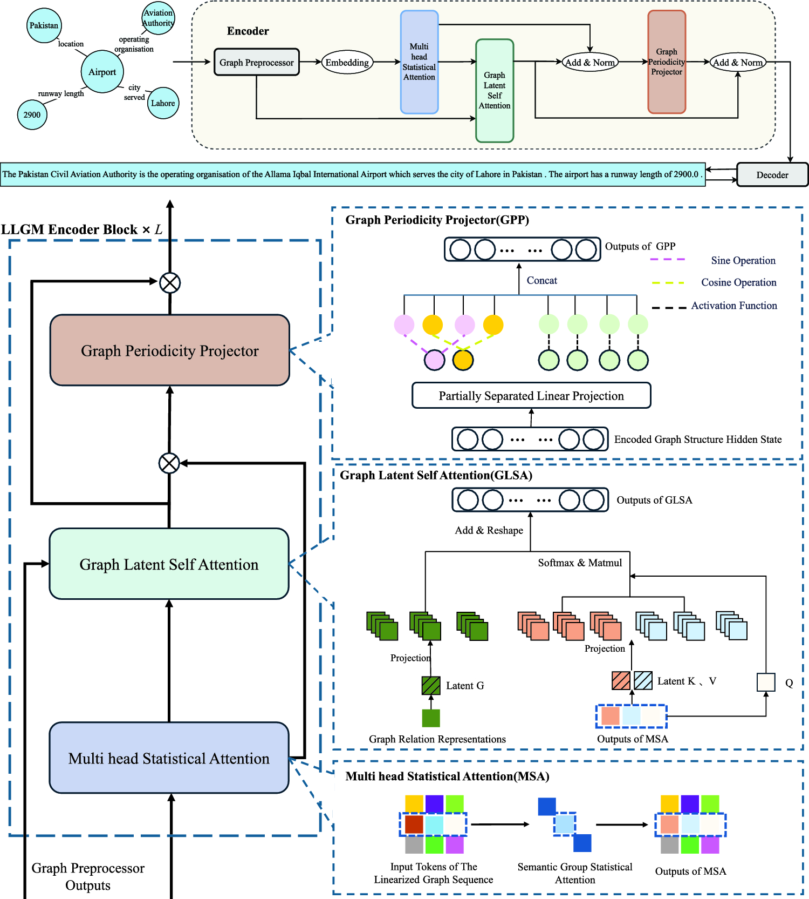
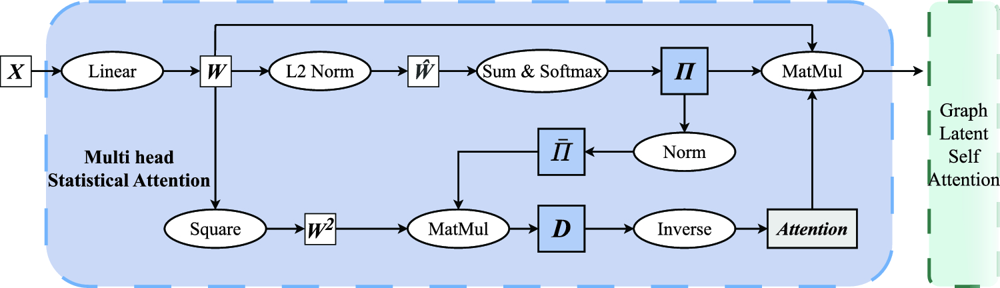
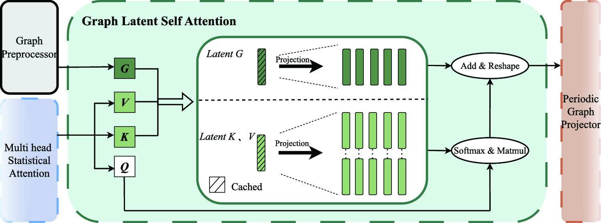
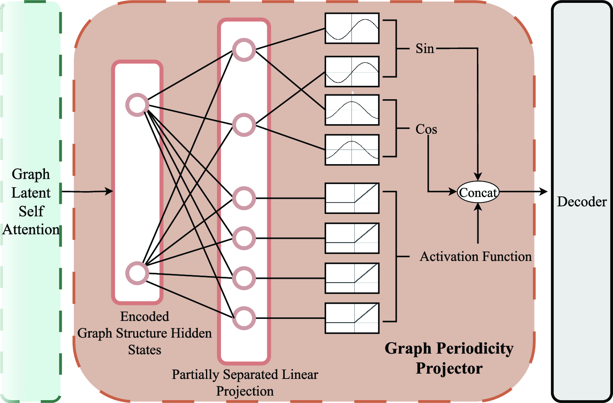
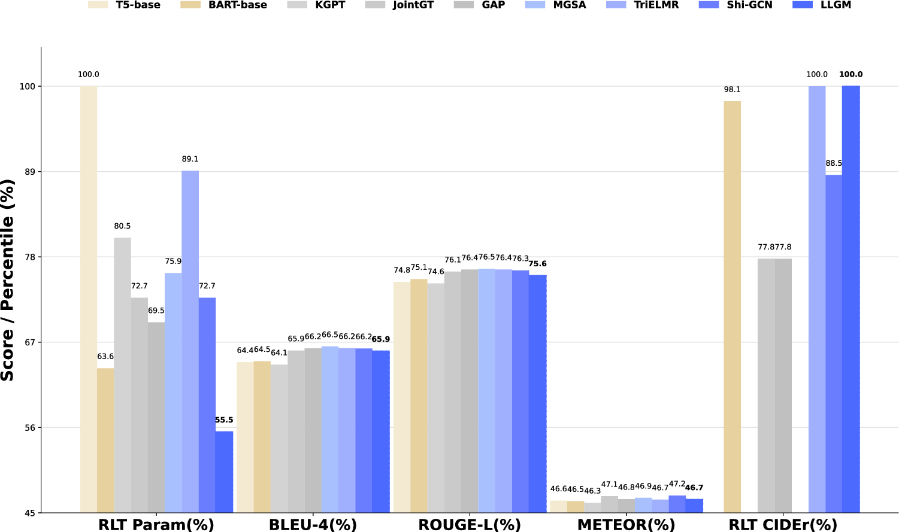

# Efficient Knowledge Graph to Text Powered by LLGM: Linear Latent Graph Model

[-0284c7?style=flat-square)](https://doi.org/10.1007/s40747-025-01985-8)
[](https://doi.org/10.1007/s40747-025-01985-8)
[](https://pytorch.org/)

> **Official Module Implementation & Research Artifacts** for the paper:  
> **"Efficient knowledge graph to text powered by LLGM: Linear Latent Graph Model"**  
> *Xiaokang Zhao et al., Complex & Intelligent Systems (Springer, 2025).*  
> 🔗 **Paper Link**: [https://doi.org/10.1007/s40747-025-01985-8](https://doi.org/10.1007/s40747-025-01985-8) · **Upstream Org**: [`LLGMTeam/LLGM-research-data`](https://github.com/LLGMTeam/LLGM-research-data)

---

## 📖 Overview & Motivation

Transforming structured **Knowledge Graphs (KGs)** into fluent, semantically faithful natural language text (**KG-to-Text Generation**) suffers from a severe computational bottleneck in standard Transformer architectures: self-attention scales quadratically ($O(N^2)$) with the number of linearized graph nodes and relational edges.

**LLGM (Linear Latent Graph Model)** addresses this bottleneck by introducing a strictly linear-complexity ($O(N)$) graph-aware encoder-decoder architecture that preserves both high-order relational topology and multi-subspace semantic representations while significantly reducing parameter overhead and inference latency.



---

## 🧩 Core Architectural Modules

This repository provides the standalone PyTorch implementations of the three core architectural innovations proposed in LLGM:

### 1. Multi-Head Statistical Attention (`MSAMultiheadStatisticalAttention.py`)
- **Class**: `MultiheadStatisticalAttention(dim, num_heads=8, dropout=0.0, qkv_bias=True)`
- **Mechanism**: Eliminates quadratic pairwise token dot-products ($Q K^\top \in \mathbb{R}^{N \times N}$) by projecting token representations into normalized statistical variance distributions with learnable temperature scaling $\tau$, reducing global token interaction complexity from $O(N^2)$ to linear $O(N)$.



### 2. Graph Latent Space Self-Attention (`GLSAGraphLatentSelfAttention.py`)
- **Class**: `GraphLatentSelfAttention(embed_dim, num_heads, dropout=0.0, bias=True, encoder_decoder_attention=False, t_emb_size=0)`
- **Mechanism**: Compresses Key-Value projections into a low-rank latent subspace (`kv_lora_rank`) while injecting low-rank relational type embeddings (`t_emb_lookup`, `t_emb_lora_rank`) conditioned on the graph adjacency structure (`attn_mask`). Supports incremental decoding state caching.



### 3. Graph Periodicity Projector (`GPPGraphPeriodicityProjector.py`)
- **Class**: `GraphPeriodicityProjector(input_dim, output_dim, bias=True, with_gate=True)`
- **Mechanism**: Maps linearized graph representations into periodic frequency bases ($\cos(\cdot)$ and $\sin(\cdot)$) fused with GELU-activated structural features via a learnable sigmoid gate (`periodicity_gate`), mitigating over-smoothing across multi-hop relational paths.



---

## 📊 Experimental Highlights

Evaluated on standard KG-to-Text benchmarks (**WebNLG v2.0** and **EventNarrative**):

- **State-of-the-Art Generation Quality**: Achieves **4.63 CIDEr (SOTA)** and **65.86% BLEU-4** on WebNLG v2.0.
- **Parameter Efficiency**: Cuts total parameter count by **20%–37%** compared to dense graph-transformer baselines (retaining only **55.5%** of baseline attention parameters).
- **Inference Acceleration**: Reduces complex multi-triple graph inference latency by **13%** ($p < 10^{-11}$).



---

## 🚀 Quick Usage

```python
import torch
from MSAMultiheadStatisticalAttention import MultiheadStatisticalAttention
from GLSAGraphLatentSelfAttention import GraphLatentSelfAttention
from GPPGraphPeriodicityProjector import GraphPeriodicityProjector

# 1. Multi-head Statistical Attention (B, N, D) -> (B, N, D)
msa = MultiheadStatisticalAttention(dim=512, num_heads=8)
x = torch.randn(4, 64, 512)
out_msa = msa(x)

# 2. Graph Periodicity Projector (B, N, D_in) -> (B, N, D_out)
gpp = GraphPeriodicityProjector(input_dim=512, output_dim=512, with_gate=True)
out_gpp = gpp(out_msa)

# 3. Graph Latent Space Self-Attention (SeqLen, B, D) -> (SeqLen, B, D)
glsa = GraphLatentSelfAttention(embed_dim=512, num_heads=8, t_emb_size=16)
seq_x = out_gpp.transpose(0, 1)  # (64, 4, 512)
adj_type_mask = torch.zeros(4, 64, 64, dtype=torch.long)
out_glsa, _ = glsa(query=seq_x, key=seq_x, attn_mask=adj_type_mask)
```

---

## 📝 Citation

If you find our work or modules useful in your research, please cite:

```bibtex
@article{zhao2025llgm,
  title   = {Efficient knowledge graph to text powered by LLGM: Linear Latent Graph Model},
  author  = {Zhao, Xiaokang and others},
  journal = {Complex \& Intelligent Systems},
  year    = {2025},
  publisher = {Springer},
  doi     = {10.1007/s40747-025-01985-8},
  url     = {https://doi.org/10.1007/s40747-025-01985-8}
}
```

---

## 📄 License

Licensed under the [Apache License 2.0](LICENSE). Redistributions and derivative works must preserve the copyright notice, [NOTICE](NOTICE) attribution, and original paper citation.
